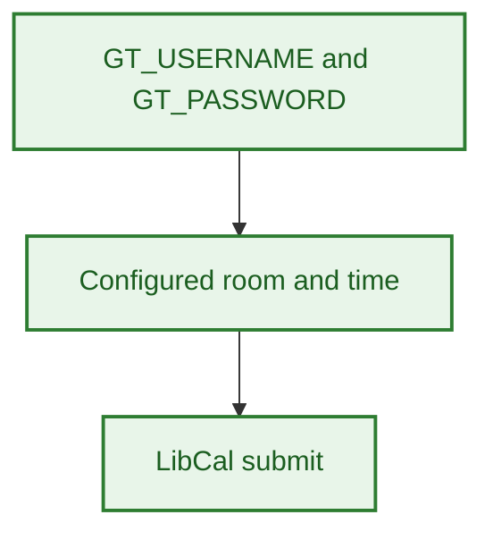
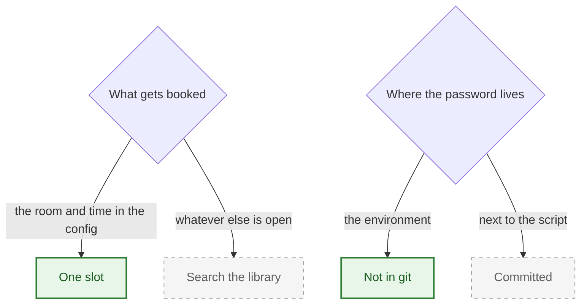

# bookRoom

Books a Georgia Tech library study room through LibCal.

## System design

How a request or a run moves through the code, then the choices behind that shape. In the decision charts, a **solid** box is the route this repo takes and a **dashed** box is the alternative it turns down; the edge label is the tradeoff.

### One slot

GT credentials come from the environment. The program checks the configured room and time, then submits that slot on LibCal. It does not search the library for a different room.

### The same room

The form is the same form most weeks, so the script books one slot. Credentials stay out of the repo. A password in the environment is still a password on the machine.

Longer write-up: [aamogh.vercel.app/projects/bookroom](https://aamogh.vercel.app/projects/bookroom.html)
