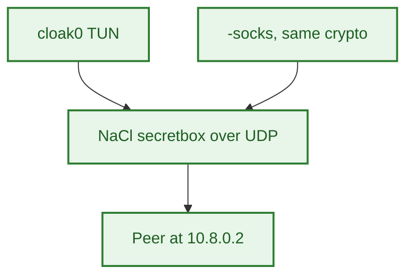
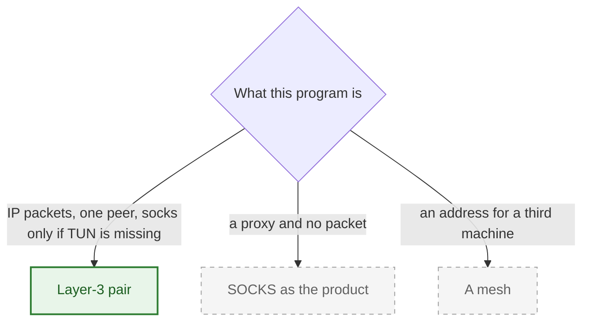

# cloak

Layer-3 VPN over UDP. Each side gets a TUN (`cloak0`), talks secretbox-encrypted IP packets to the other, and assigns tunnel addresses like `10.8.0.1/24` / `10.8.0.2/24`. Ping the peer's tunnel IP and you've got a real VPN lab — not just SOCKS.

Needs admin (and on Windows, Wintun). If you can't do that, `-socks` still does the old userspace proxy exit.

## VPN mode

```bash
cd cloak
go build -o cloak.exe .

# admin / sudo
./cloak.exe server -listen :51820 -key lab-psk -tun cloak0 -addr 10.8.0.1/24
./cloak.exe client -server 127.0.0.1:51820 -key lab-psk -tun cloak0 -addr 10.8.0.2/24

ping 10.8.0.1
```

Optional `-route 192.168.50.0/24` adds that CIDR via the tunnel gateway (first host in `-addr`'s subnet, usually `10.8.0.1`). Full-tunnel `0.0.0.0/0` is a bad idea on your laptop without also carving out the UDP server path — do it deliberately.

## Windows

Run an elevated shell. Drop `wintun.dll` (amd64 from [wintun.net](https://www.wintun.net/)) next to `cloak.exe`. Without it, TUN create fails; use SOCKS mode instead.

## SOCKS fallback

```bash
./cloak.exe server -listen :51820 -key lab-psk -socks
./cloak.exe client -server 127.0.0.1:51820 -key lab-psk -socks 127.0.0.1:1080
curl --socks5-hostname 127.0.0.1:1080 https://example.com
```

## Notes

`-key` / `CLOAK_KEY`: 64-char hex or any passphrase (sha256). Wire: `version | nonce | secretbox(type+stream+seq+body)` — VPN uses `msgPacket` / `msgHello`; SOCKS still uses the stream types. TUN via `golang.zx2c4.com/wireguard/tun`.

Tests: `go test ./...`

## System design

How a request or a run moves through the code, then the choices behind that shape. In the decision charts, a **solid** box is the route this repo takes and a **dashed** box is the alternative it turns down; the edge label is the tradeoff.

### One packet

Each side opens cloak0 , wraps the IP packet with NaCl secretbox, and sends it over UDP. -socks keeps that same framing when TUN is unavailable.



### A tunnel, not a mesh

The program is a pair of tunnel addresses. SOCKS is the fallback for a machine without admin, not the product. A third machine does not get an address from cloak.



Longer write-up: [aamogh.vercel.app/projects/cloak](https://aamogh.vercel.app/projects/cloak.html)
