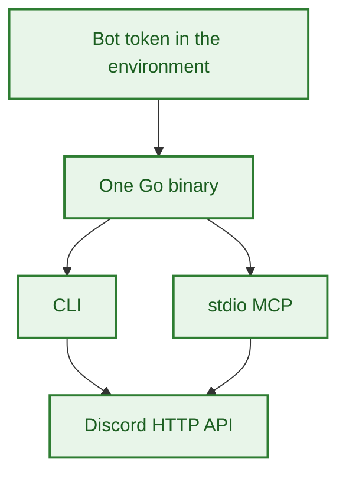
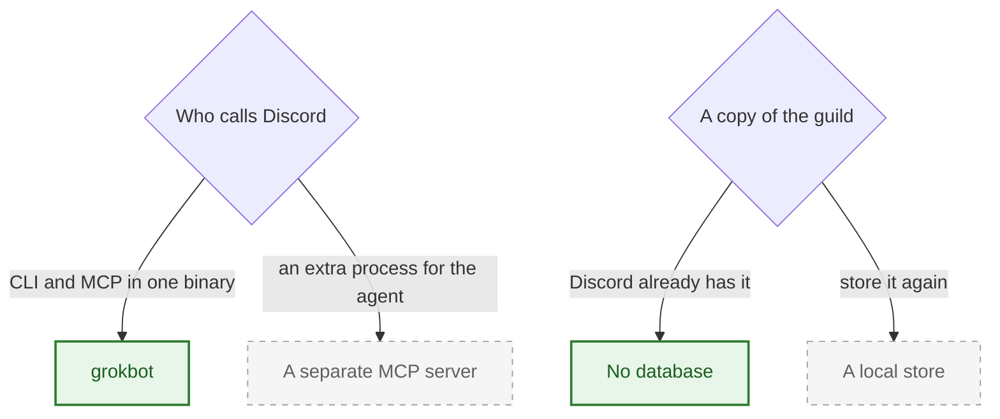

# grokbot

Discord tools for Grok Bot. One Go binary, two modes:

- **CLI** — Grok Bot runs it from its terminal.
- **MCP server** (`grokbot mcp`, stdio) — exposes the same commands as MCP tools:
  `list_guilds`, `list_channels`, `read_messages`, `send_message`, `send_as_me`.

## Setup

1. https://discord.com/developers/applications → New Application → Bot → Reset Token, copy it.
2. Bot tab: enable **Message Content Intent**.
3. OAuth2 → URL Generator: scope `bot`, permissions `View Channels`, `Send Messages`,
   `Read Message History`. Open the URL, add the bot to your server.
4. Copy `.env.example` to `.env` (next to the binary or in the working dir), paste token.

### Post as you (webhook)

`say` / `send_as_me` post through a webhook, so messages show your name and avatar
(with Discord's "APP" tag). No bot token needed for this.

1. Channel → Edit Channel → Integrations → Webhooks → New Webhook.
2. Set its name and avatar to yours, then Copy Webhook URL.
3. Put it in `.env` as `DISCORD_WEBHOOK_URL`. One webhook = one channel.

Anyone with the URL can post as that webhook — treat it like a password.

## Build

```
go build -o grokbot.exe .                       # Windows
GOOS=linux GOARCH=amd64 go build -o grokbot .   # Linux (Grok Bot computer)
```

## Use

```
grokbot guilds
grokbot channels <guild_id>
grokbot read <channel_id> [limit]
grokbot send <channel_id> "hello"
grokbot say "hello"
grokbot mcp
```

## On the Grok Bot computer

Copy the Linux binary and `.env` over, then add to the bot's instructions:

> For Discord, run `./grokbot <command>`.
> Commands: guilds, channels <guild_id>, read <channel_id> [limit], send <channel_id> "msg",
> say "msg" (posts as me).

Note: all Bots on an account share one computer, so every Bot can read `.env`.

## System design

How a request or a run moves through the code, then the choices behind that shape. In the decision charts, a **solid** box is the route this repo takes and a **dashed** box is the alternative it turns down; the edge label is the tradeoff.

### CLI or MCP

One binary. As a CLI it prints guilds and channels. As a stdio MCP server it exposes the same calls. Both use the Discord HTTP API and the bot token from the environment.



### No second server

Listing guilds, reading a channel, and sending a message are the same three calls for a person or an MCP client. A second process would only hide the token somewhere else. There is no database, and no allowlist beyond the token’s Discord permissions.



Longer write-up: [aamogh.vercel.app/projects/grokbot](https://aamogh.vercel.app/projects/grokbot.html)
