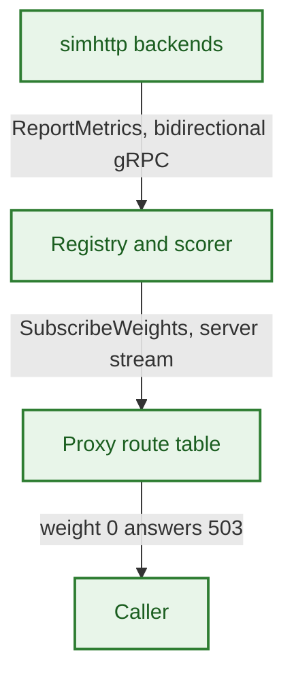
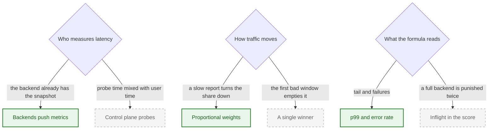

# hotwire

Control plane that scores backends on latency and error rate, then pushes routing weights to proxies over gRPC streams.

Backends run `simhttp` and report metrics on a bidirectional stream. Proxies subscribe to weight updates and pick backends probabilistically. Stale backends (no report for >3s) get weight 0.

The `demo` command starts the control plane, a few fake backends with different latency profiles, and a proxy on one port — useful for watching weights shift as you tweak backend behavior.

## Run

```powershell
cd hotwire
go mod tidy
go build -o hotwire.exe ./cmd/hotwire

# all-in-one demo
go run ./cmd/hotwire demo

# or piecemeal
go run ./cmd/hotwire serve
go run ./cmd/hotwire backend alpha --latency 15ms --http 127.0.0.1:18081
go run ./cmd/hotwire proxy --route alpha=http://127.0.0.1:18081 --port 8080
go run ./cmd/hotwire watch
```

## RPCs

- `ReportMetrics` (bidi): backend telemetry in, weight ack out
- `SubscribeWeights` (server stream): routing table fanout
- `ListBackends` (unary): snapshot

## Proto regen

```powershell
protoc --go_out=. --go_opt=module=github.com/aamoghS/sideprojects/hotwire \
  --go-grpc_out=. --go-grpc_opt=module=github.com/aamoghS/sideprojects/hotwire \
  proto/hotwire/v1/hotwire.proto
```

Tests: `go test ./...`

## System design

How a request or a run moves through the code, then the choices behind that shape. In the decision charts, a **solid** box is the route this repo takes and a **dashed** box is the alternative it turns down; the edge label is the tradeoff.

### Control loop

Backends stream snapshots. The control plane keeps the latest report and publishes weights. The proxy already knows each URL from --route and never parses the metrics.



### What moves traffic

The backend already measured the request, so the control plane does not send its own probes. A slow report lowers that backend’s share. It does not drop the backend on the first bad window. The formula reads p99 and error rate. Inflight stays on the report and out of the score.



Longer write-up: [aamogh.vercel.app/projects/hotwire](https://aamogh.vercel.app/projects/hotwire.html)
