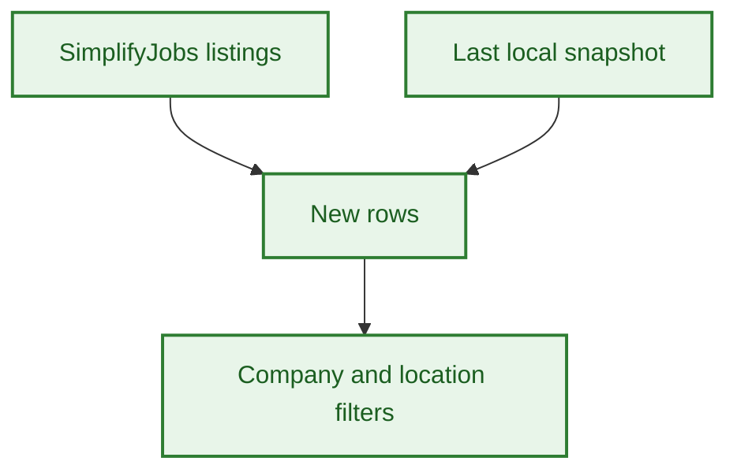
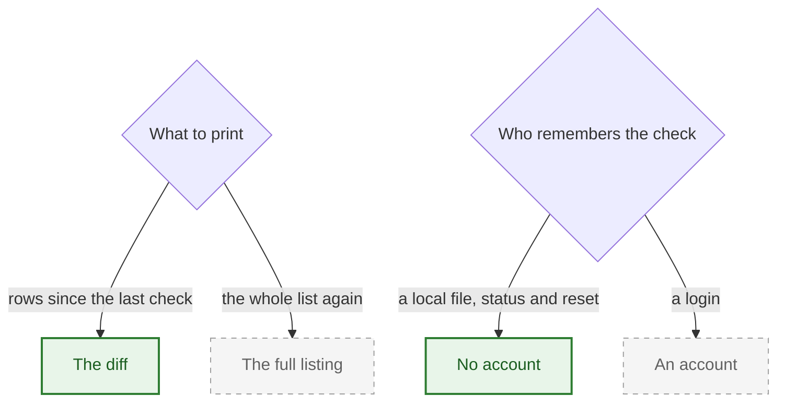

# simplijobs

Tracks new internship and new-grad postings from the [SimplifyJobs](https://github.com/SimplifyJobs) GitHub repos. Instead of manually diffing markdown tables in the browser, `check` fetches the current listings, compares against local state from your last run, and prints only what's new.

`status` shows when you last checked each source. `reset` clears that history if you want a fresh baseline.

## Build

```bash
cd ideas/simplijobs
go mod tidy
go build -o simplijobs.exe .
```

## Usage

```bash
simplijobs.exe check internships
simplijobs.exe check newgrad
simplijobs.exe check newgrad --all
simplijobs.exe status
simplijobs.exe reset
```

Filters: `--company`, `--location`, `--limit`, `--no-color`.

## System design

How a request or a run moves through the code, then the choices behind that shape. In the decision charts, a **solid** box is the route this repo takes and a **dashed** box is the alternative it turns down; the edge label is the tradeoff.

### New rows only

check fetches SimplifyJobs listings, compares them to the last local snapshot, and prints the new ones. Company and location filters sit on that diff. status shows the last check. reset forgets it.



### A diff, stored locally

The list is long and most of it was there yesterday. Remembering the last check is the product. There is no account. A changed title looks new. A listing that disappeared is not the headline.



Longer write-up: [aamogh.vercel.app/projects/simplijobs](https://aamogh.vercel.app/projects/simplijobs.html)
