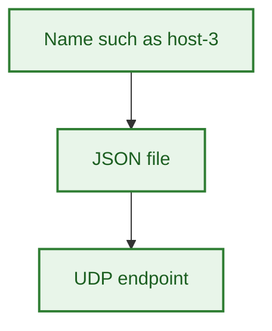
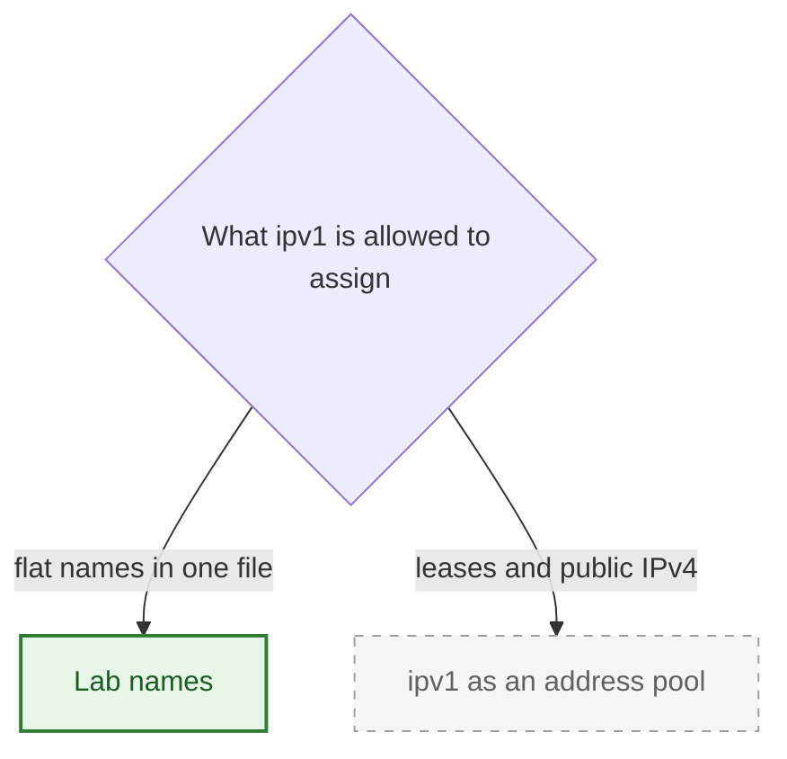

# ipv1

A joke "Internet Protocol version 1" for lab networks. Addresses are flat names like `1`, `42`, or `host-3` — not dotted quads. A JSON registry maps each name to a UDP endpoint; packets carry src, dst, and payload over UDP with a tiny binary header.

Dev boxes and VMs pile up fast. Remembering `10.0.0.17:9876` for the thing you spun up yesterday is worse than typing `3`. This is DNS-shaped naming without pretending to be real IP.

## Run

```bash
cd ipv1
go build -o ipv1.exe ./cmd/ipv1

# terminal A
./ipv1.exe listen 1 --port 9000

# terminal B
./ipv1.exe register 3 127.0.0.1:9001
./ipv1.exe listen 3 --port 9001

# terminal C
./ipv1.exe send 1 3 "hello"
```

Registry defaults to `.ipv1/registry.json`. `listen` auto-registers its endpoint; `allocate` hands out the next free numeric address.

Tests: `go test ./...`

Plate's `internal/ippool` handles real IPv4 for VMs. ipv1 is the flat-name toy layer on top — optional `ipv1_addr` on plate VM records if you want both.

## System design

How a request or a run moves through the code, then the choices behind that shape. In the decision charts, a **solid** box is the route this repo takes and a **dashed** box is the alternative it turns down; the edge label is the tradeoff.

### A name to a socket

A name such as 1 or host-3 is a row in a JSON file. The file maps it to a UDP endpoint. There is no lease and no DHCP.



### Not the address pool

Plate’s ippool assigns real IPv4 and skips the network and broadcast addresses. ipv1 does not. Two copies of the JSON file can disagree, and nothing gossips a correction.



Longer write-up: [aamogh.vercel.app/projects/ipv1](https://aamogh.vercel.app/projects/ipv1.html)
