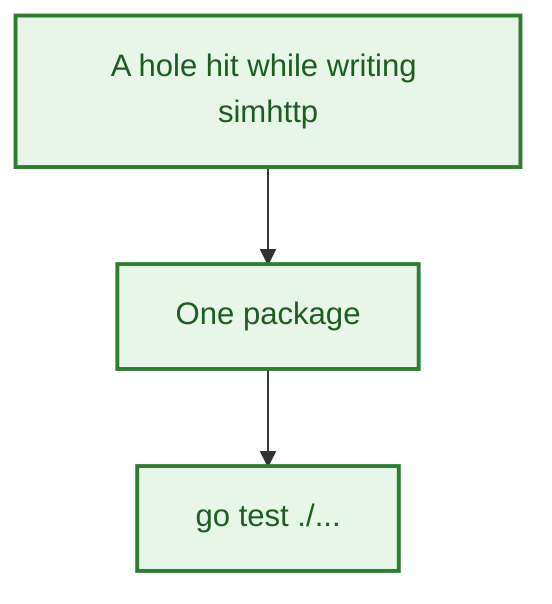
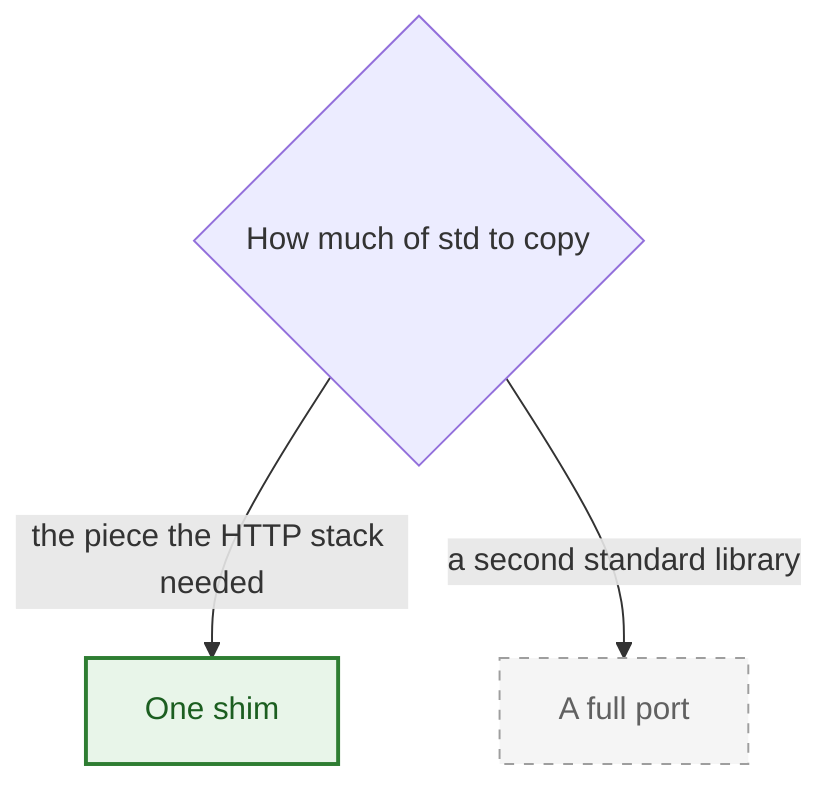

# minstd

Small stdlib shims used by `simhttp`. Each package covers one gap in the standard library — `atomic`, `sync`, `math`, `chrono`, `strings`, `io`, `bufio`, `net`, `strconv`, `errors`, `http` — without trying to be a full replacement.

Started as copy-paste from experiments that needed slightly different HTTP or timing behavior than `net/http` gives you out of the box.

Local monorepo:

```go
replace minstd => ../minstd
```

TCP in `net/` uses syscalls on Windows/Linux. Tests: `go test ./...`.

## System design

How a request or a run moves through the code, then the choices behind that shape. In the decision charts, a **solid** box is the route this repo takes and a **dashed** box is the alternative it turns down; the edge label is the tradeoff.

### One package per gap

http has a request, a response, a status, and a server. net splits Unix and Windows sockets. Each package is a hole from the simhttp work, tested with go test ./... .



### A shim, not a port

The packages are not drop-in replacements for the standard library. A shim that almost matches is worse than no shim, because the missing method is the one you call. These tests cover what the packages claim.



Longer write-up: [aamogh.vercel.app/projects/minstd](https://aamogh.vercel.app/projects/minstd.html)
