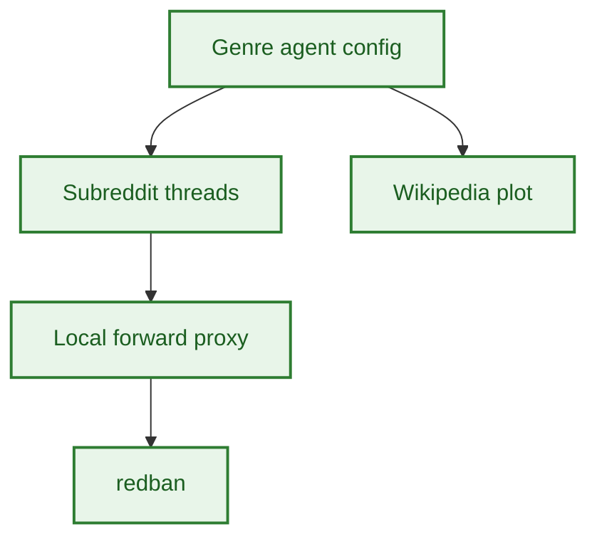
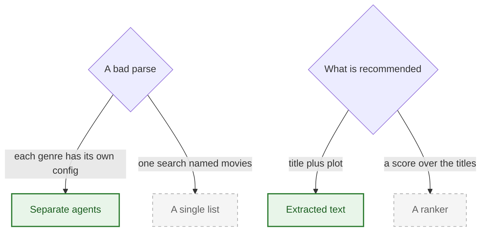

# movie

Multi-agent movie recommendation scraper. Each agent in `config/agents.json` has a genre focus, a set of subreddits, search queries, and seed picks. At runtime the tool searches Reddit for recommendation threads, extracts movie titles from posts and comments, scores them, and optionally enriches results with Wikipedia plot summaries.

Agents can run in parallel with a worker pool. For distributed runs there is an orchestrator that hands out agent indices and a separate edge proxy for routing outbound traffic.

## Proxy stack

Scraping Reddit from a home IP gets blocked quickly. The repo includes:

- `cmd/localproxy` — local HTTP forward proxy (see `LOCAL-PROXY.md`)
- `cmd/edgeproxy` — edge-facing proxy for remote workers
- `config/PROXY-SETUP.md` and `config/SELF-HOST-PROXY.md` — wiring guides

## Run

```bash
cd movie
go mod tidy

# default: all agents from config/agents.json
go run ./cmd/movie-finder

# single agent, JSON output
go run ./cmd/movie-finder -agent drama -output results.json

# test proxy connectivity
go run ./cmd/movie-finder -test-proxies -docket config/proxy-docket.json
```

Offline mode (`-offline`) skips live Reddit/Wikipedia fetches and uses seed picks only — useful for testing output formatting.

## System design

How a request or a run moves through the code, then the choices behind that shape. In the decision charts, a **solid** box is the route this repo takes and a **dashed** box is the alternative it turns down; the edge label is the tradeoff.

### Genre agent

An agent is a config: subreddits, seeds, a genre. Threads are fetched through one local forward proxy and redban. Wikipedia attaches a plot. An optional orchestrator can run agents as separate workers.



### Split the genres

A bad parse in one genre does not throw away the others. The recommendation is the extracted title plus the plot. There is no model ranking them. The proxy is local so the request’s origin stays on this machine.



Longer write-up: [aamogh.vercel.app/projects/movie](https://aamogh.vercel.app/projects/movie.html)
