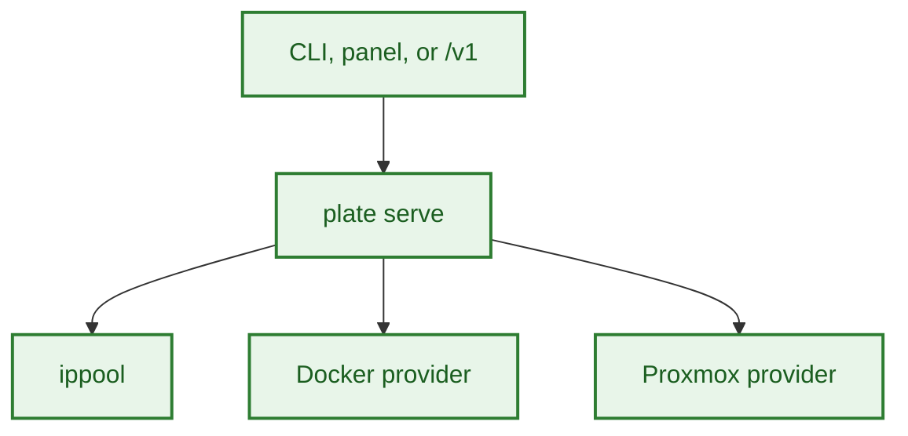
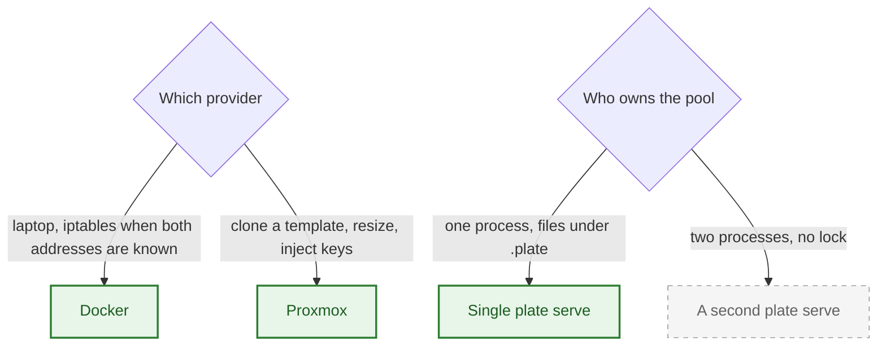

# plate

Minimal VPS control plane in Go. You run `plate serve` on a host; customers create VMs through the HTTP API, CLI, or built-in panel.

```
  CLI / panel / API  -->  plate  -->  docker (dev) or proxmox (real KVM)
```

Built-in: public IP pool, firewall + reverse DNS, SSH key injection, accounts/API tokens, usage billing, snapshots, health checks, web panel.

## Quick start (Docker provider)

Good for learning the control plane on any machine with Docker installed.

```bash
cd plate
chmod +x run.sh          # once
./run.sh                 # build + serve on :8080
./run.sh create --name crawl-1 --plan medium
./run.sh list
```

Open the panel at http://127.0.0.1:8080/panel

Optional: `cp plate.env.example plate.env` to set provider, listen addr, IP pool, proxmox creds.

Manual build:

```bash
go build -o plate ./cmd/plate
./plate serve --provider docker --listen :8080
```

Plans: `tiny`, `small`, `medium`, `large` (CPU/RAM/disk).

State lives in `.plate/` (vms, accounts, billing, ip-pool).

## Public IP pool

Set `PLATE_IP_POOL` on first run (stored in `.plate/ip-pool.json`). Accepts comma-separated hosts or CIDR blocks:

```bash
export PLATE_IP_POOL=203.0.113.10,203.0.113.11,203.0.113.12
# or a whole subnet (skips network/broadcast):
export PLATE_IP_POOL=10.0.0.0/24
```

IPs are assigned on VM create and released on delete. Check usage with `GET /v1/ip-pool` (also `/v1/ippool`).

Docker applies iptables DNAT on Linux when both public and container IPs are known. For Proxmox static IPs, set `PLATE_IP_POOL_GW` and optionally `PLATE_IP_POOL_PREFIX` (default `24`).

## Accounts and API tokens

Create an account and token:

```bash
curl -X POST localhost:8080/v1/accounts -d '{"name":"acme"}'
curl -X POST localhost:8080/v1/accounts/<id>/tokens -d '{"label":"deploy"}'
```

Once any token exists, `/v1/*` endpoints (except `POST /v1/accounts` and `GET /v1/plans`) require `Authorization: Bearer plt_...`.

Usage records land in `.plate/billing.json`. Query with `GET /v1/billing?account_id=<id>`.

## Real VPS path (Proxmox + KVM)

Run the control plane on a Linux box with [Proxmox VE](https://www.proxmox.com/) installed.

1. Create a Ubuntu cloud-init **template VM** (e.g. VMID `9000`).
2. Set env vars:

```bash
export PLATE_PROXMOX_URL=https://your-host:8006
export PLATE_PROXMOX_USER=root@pam
export PLATE_PROXMOX_PASSWORD=secret
export PLATE_PROXMOX_NODE=pve
export PLATE_PROXMOX_TEMPLATE=9000
export PLATE_PROXMOX_STORAGE=local-lvm
export PLATE_PROXMOX_BRIDGE=vmbr0
export PLATE_PROXMOX_INSECURE=true   # only if using self-signed TLS
```

3. Start the server:

```bash
./plate serve --provider proxmox --listen :8080
./plate create --name customer-1 --plan small
```

Plate clones your template, resizes CPU/RAM/disk, injects SSH keys via cloud-init, and starts the VM.

## HTTP API

| Method | Path | Action |
|--------|------|--------|
| GET | `/v1/plans` | List plans |
| GET | `/v1/ip-pool` | IP pool status (alias: `/v1/ippool`) |
| POST | `/v1/accounts` | Create account |
| GET | `/v1/accounts` | List accounts |
| POST | `/v1/accounts/{id}/tokens` | Create API token |
| GET | `/v1/billing` | Usage records |
| GET | `/v1/vms` | List VMs (includes health) |
| POST | `/v1/vms` | Create VM |
| GET | `/v1/vms/{id}` | Get VM |
| POST | `/v1/vms/{id}/start` | Start |
| POST | `/v1/vms/{id}/stop` | Stop |
| DELETE | `/v1/vms/{id}` | Delete |
| PUT | `/v1/vms/{id}/firewall` | Set firewall rules |
| PUT | `/v1/vms/{id}/hostname` | Set reverse DNS hostname |
| GET | `/v1/vms/{id}/snapshots` | List snapshots |
| POST | `/v1/vms/{id}/snapshots` | Create snapshot |
| POST | `/v1/vms/{id}/snapshots/{snapId}/restore` | Restore snapshot |
| GET | `/panel` | Web panel |

Create VM body:

```json
{
  "name": "web-1",
  "plan": "small",
  "hostname": "web-1.example.com",
  "ssh_keys": ["ssh-ed25519 AAAA..."],
  "firewall": [{"protocol":"tcp","port":22,"label":"ssh"}],
  "account_id": "abc123"
}
```

Default firewall on create: SSH (22), HTTP (80), HTTPS (443).

## Tests

```bash
go test ./...
```

## System design

How a request or a run moves through the code, then the choices behind that shape. In the decision charts, a **solid** box is the route this repo takes and a **dashed** box is the alternative it turns down; the edge label is the tradeoff.

### Create a machine

The CLI, the panel, and /v1 hit one process. That process assigns an address from the pool, then calls whichever provider is configured.



### One process, two providers

Docker is the laptop path. Proxmox clones a cloud-init template and starts a real VM. State is JSON under .plate/ . A second plate serve would also believe it owns the pool. There is no lock and no leader election.



Longer write-up: [aamogh.vercel.app/projects/plate](https://aamogh.vercel.app/projects/plate.html)
