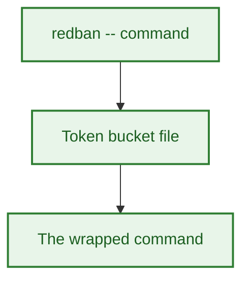
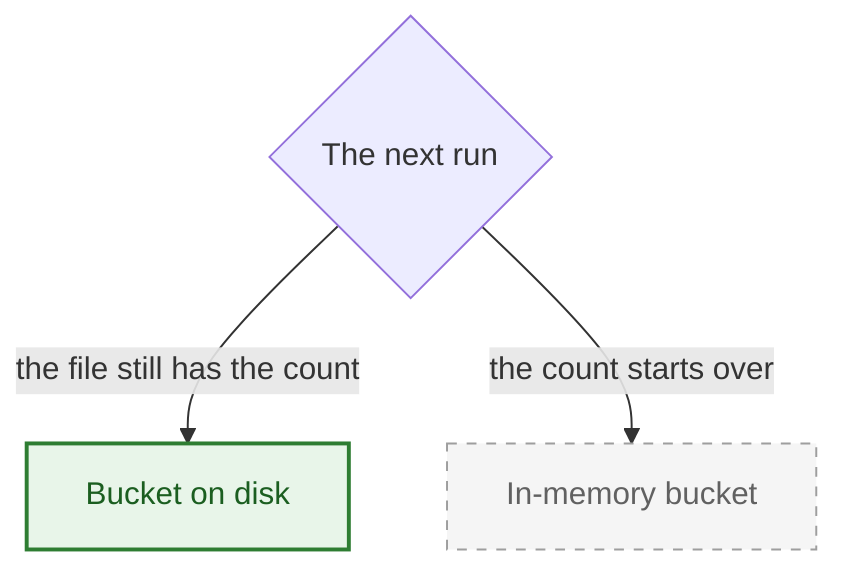

# redban

`movie` hammers old.reddit.com from a bunch of agents and gets 429s if you don't pace requests. This is a token bucket with state saved to disk so restarts don't reset your budget.

Default is 30 req/min with burst 5 — conservative on purpose. Run your curl/fetch after `--`:

```bash
cd redban
go build -o redban.exe .
./redban.exe -- curl -s "https://old.reddit.com/r/movies/search.json?q=underrated&restrict_sr=1"
./redban.exe -rpm 45 -state /tmp/reddit.tokens -- your-scraper-binary -agent drama
```

`./redban.exe` with no command just waits until a token is free and prints the balance.

## System design

How a request or a run moves through the code, then the choices behind that shape. In the decision charts, a **solid** box is the route this repo takes and a **dashed** box is the alternative it turns down; the edge label is the tradeoff.

### Wrap a command

redban -- then the command. The token bucket is a file, so the next run remembers the last one. movie uses it. A one-off curl can use the same file.



### The limit outlives the process

An in-memory bucket resets every time the tool starts, which spends the unauthenticated Reddit quota halfway through a genre. The file does not know why a host returned 429. It only counts the tokens you configured.



Longer write-up: [aamogh.vercel.app/projects/redban](https://aamogh.vercel.app/projects/redban.html)
