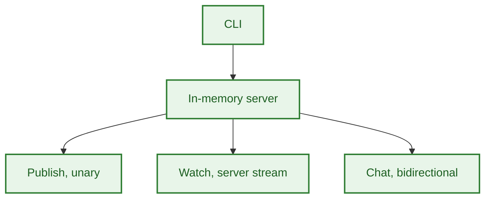
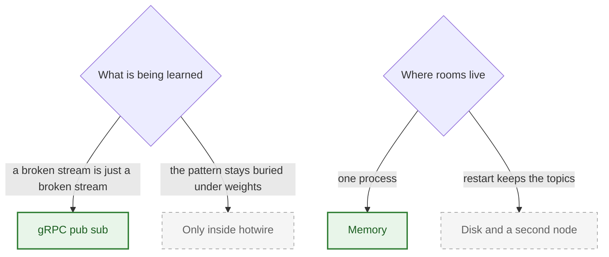

# relay

gRPC pub/sub CLI. Three modes: fire-and-forget publish to a topic, server-streaming watch on a topic, and bidirectional room chat where everyone in a room sees each other's messages.

The server keeps an in-memory store — fine for local dev and demos, not for production persistence.

## Build

```bash
cd relay
go mod tidy
go build -o relay.exe ./cmd/relay
```

## Usage

```bash
./relay.exe serve
./relay.exe watch logs
./relay.exe publish logs "hello"
./relay.exe room hackathon --name alice
```

Proto regen:

```bash
protoc --go_out=. --go_opt=module=github.com/aamoghS/sideprojects/relay \
  --go-grpc_out=. --go-grpc_opt=module=github.com/aamoghS/sideprojects/relay \
  proto/relay/v1/relay.proto
```

Tests: `go test ./...`

## System design

How a request or a run moves through the code, then the choices behind that shape. In the decision charts, a **solid** box is the route this repo takes and a **dashed** box is the alternative it turns down; the edge label is the tradeoff.

### Three RPC shapes

Publish is unary. Watch is a server stream. Chat is bidirectional. The server keeps topics in memory. There is no disk.



### Streams without a score

Hotwire uses the same three RPC shapes under a scorer. Relay is those streams on their own. Restarting the server drops the topics. A second node is a different program.



Longer write-up: [aamogh.vercel.app/projects/relay](https://aamogh.vercel.app/projects/relay.html)
