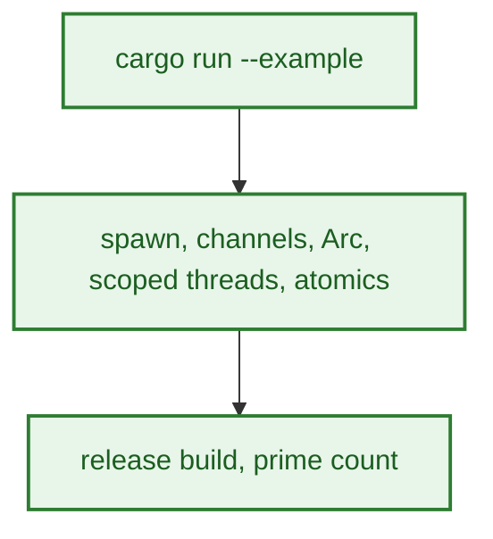
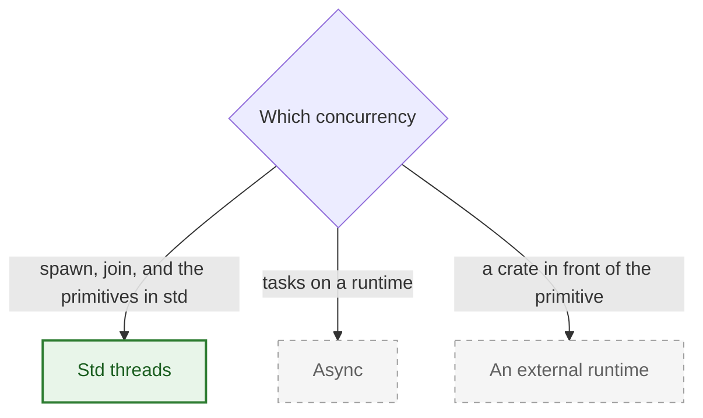

# rust-concurrent-threads

Small, std-only walkthrough of how threads work in Rust. Each example adds one idea.

| Run | Shows |
|-----|-------|
| `cargo run --example 01_spawn_join` | `thread::spawn` starts an OS thread; `join()` waits and returns its value. Output order changes run to run. |
| `cargo run --example 02_channels` | Message passing with `mpsc`. Every producer holds a `Sender` clone; the receive loop ends when the last one is dropped. |
| `cargo run --release --example 03_arc_mutex` | Shared state. `Arc` gives each thread ownership of the same counter, `Mutex` lets one thread change it at a time. 8 threads x 100,000 increments, none lost. |
| `cargo run --example 04_scoped_atomics` | `thread::scope` lets threads borrow local data (no `Arc`, no `move` of owned data) because they are joined before the scope ends. Disjoint `&mut` slices need no lock; `AtomicUsize` counts lock-free. |
| `cargo run --release` | Payoff: counts primes below 3,000,000 on one thread, then on every core, and prints the speedup. |

## Why Rust needs `Arc` and `Mutex`

Sharing a plain `let mut count` between threads does not compile:

```rust
let mut count = 0;
let handles: Vec<_> = (0..4).map(|_| thread::spawn(|| count += 1)).collect();
// error[E0597]: `count` does not live long enough
```

`thread::spawn` requires `'static` data, because a spawned thread can outlive the function that started it. And mutation from several threads needs a type that is `Sync`. The compiler rejects the data race before the program ever runs. The fix is `Arc<Mutex<_>>` (example 03), or a scope that ends before the data does (example 04).

## Measured speedup

On a 4-core / 8-thread machine, `cargo run --release` gave 2.0x to 2.8x across three runs (about 500 ms on one thread, 200 to 235 ms on 8). The ceiling is about 4x: the 8 hardware threads share 4 cores' worth of division units. Other programs running at the same time take cores too.

## System design

How a request or a run moves through the code, then the choices behind that shape. In the decision charts, a **solid** box is the route this repo takes and a **dashed** box is the alternative it turns down; the edge label is the tradeoff.

### One example, then a number

Each file is one idea: spawn and join, channels, Arc<Mutex> , scoped threads, atomics. cargo run --example runs that idea. cargo run --release counts primes on every core and prints the speedup.



### Threads, not a runtime

The question is cores and the primitives in std. An async runtime answers a different question. A crate would hide the part the examples are there to show. Sharing is a channel, an Arc, or a scoped thread.



Longer write-up: [aamogh.vercel.app/projects/rust-concurrent-threads](https://aamogh.vercel.app/projects/rust-concurrent-threads.html)
