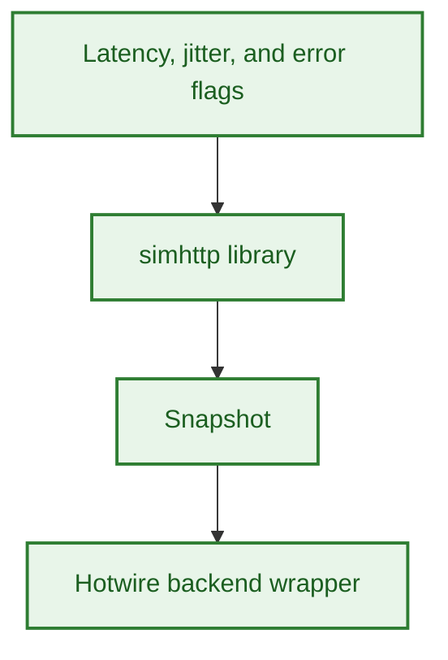
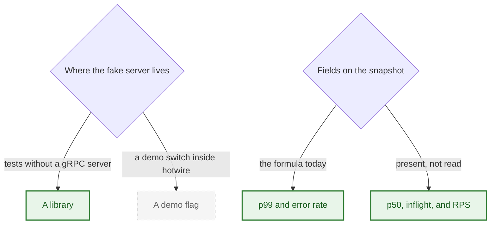

# simhttp

Fake HTTP backend for load tests. You configure latency, jitter, and error rate per instance; it serves a simple handler and tracks p50/p99, error rate, inflight requests, and RPS. `hotwire` backends wrap this and stream the snapshots to the control plane.

Depends on `minstd` for HTTP and timing primitives.

```go
backend, err := simhttp.New(simhttp.Config{
    Name:      "alpha",
    Addr:      "127.0.0.1:8081",
    Latency:   simhttp.FromDuration(20 * time.Millisecond),
    Jitter:    simhttp.FromDuration(5 * time.Millisecond),
    ErrorRate: 0.01,
})
snap := backend.Snapshot()
err = backend.Run(ctx)
```

Monorepo:

```go
replace simhttp => ../simhttp
replace minstd => ../minstd
```

## System design

How a request or a run moves through the code, then the choices behind that shape. In the decision charts, a **solid** box is the route this repo takes and a **dashed** box is the alternative it turns down; the edge label is the tradeoff.

### A dishonest backend

Flags set latency, jitter, and error rate. The library serves HTTP and snapshots p50, p99, error rate, inflight, and RPS. A hotwire backend is a thin wrapper that streams that snapshot.



### A library, not a flag

The fake server is its own module so go test can check latency without gRPC. Hotwire’s score reads p99 and error rate. The other fields stay on the snapshot for a later formula, without a new RPC.



Longer write-up: [aamogh.vercel.app/projects/simhttp](https://aamogh.vercel.app/projects/simhttp.html)
