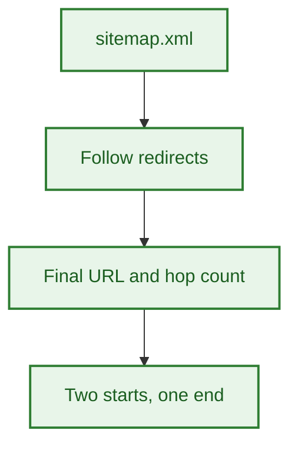
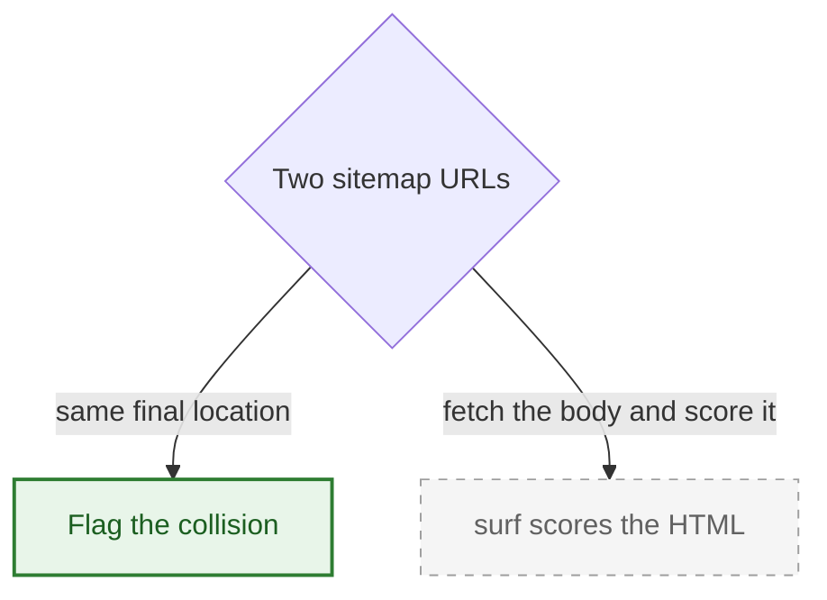

# slugcheck

`surf` audits page content; this checks the URL layer. Point it at a site, it reads `sitemap.xml`, follows redirects, and prints slug collisions (multiple sitemap entries landing on the same final URL) plus chains that bounce too many times.

Handy after a Next.js migration when old blog paths and new ones both show up in Search Console.

```bash
cd slugcheck
go build -o slugcheck.exe .
./slugcheck.exe https://example.com
./slugcheck.exe -sitemap https://example.com/sitemap-0.xml https://example.com
```

## System design

How a request or a run moves through the code, then the choices behind that shape. In the decision charts, a **solid** box is the route this repo takes and a **dashed** box is the alternative it turns down; the edge label is the tradeoff.

### Sitemap to a final URL

Start at sitemap.xml , follow each URL, and record the final location and the hop count. A collision is two starts with one end. A chain that bounces too many times is its own flag.



### The URL, before the HTML

surf scores the page. slugcheck does not fetch the body to do that. A redirect bug would otherwise show up as a duplicate title warning, or not show up at all.



Longer write-up: [aamogh.vercel.app/projects/slugcheck](https://aamogh.vercel.app/projects/slugcheck.html)
