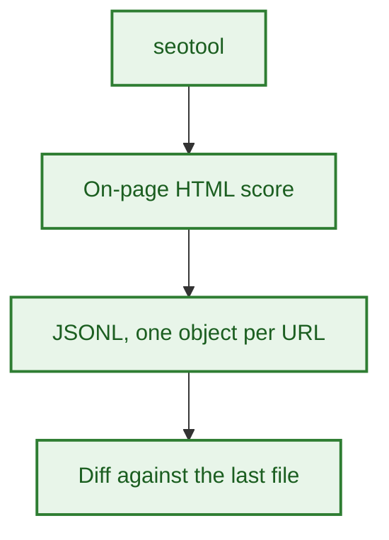
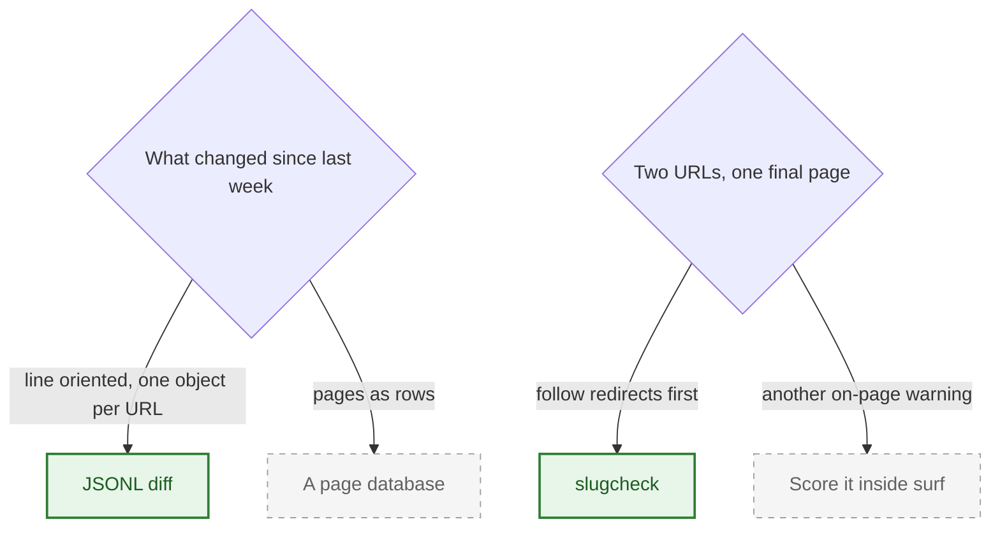

# surf

CLI for crawling sites and auditing on-page SEO. Given a URL it fetches the page, checks title/meta/heading structure, link hygiene, and similar signals, then scores what needs fixing.

The `audit` and `batch` commands crawl multiple pages and write results to JSONL. `plan` turns audit output into a prioritized fix list; `diff` compares before/after audits so you can see what changed after deploying fixes.

## Build

```bash
cd surf
go mod tidy
go build -o seotool.exe ./cmd/seotool
```

## Commands

```bash
./seotool.exe analyze --url https://example.com
./seotool.exe audit --url https://example.com --depth 2 --output audit.jsonl
./seotool.exe batch --urls-file config/urls.example.txt --output results.jsonl
./seotool.exe plan --input audit.jsonl
./seotool.exe diff --before audit-before.jsonl --after audit-after.jsonl
```

Tests: `go test ./...`

## System design

How a request or a run moves through the code, then the choices behind that shape. In the decision charts, a **solid** box is the route this repo takes and a **dashed** box is the alternative it turns down; the edge label is the tradeoff.

### Crawl to a file

The binary is seotool . It fetches pages, scores on-page HTML, and in batch mode writes one JSON object per URL. Last week’s JSONL diffs against today’s.



### A file, not a page database

A database of pages is the wrong store for a rerun. slugcheck is the other half: it follows redirects and flags two sitemap URLs that land on one page. That check stays out of the title-length warnings.



Longer write-up: [aamogh.vercel.app/projects/surf](https://aamogh.vercel.app/projects/surf.html)
